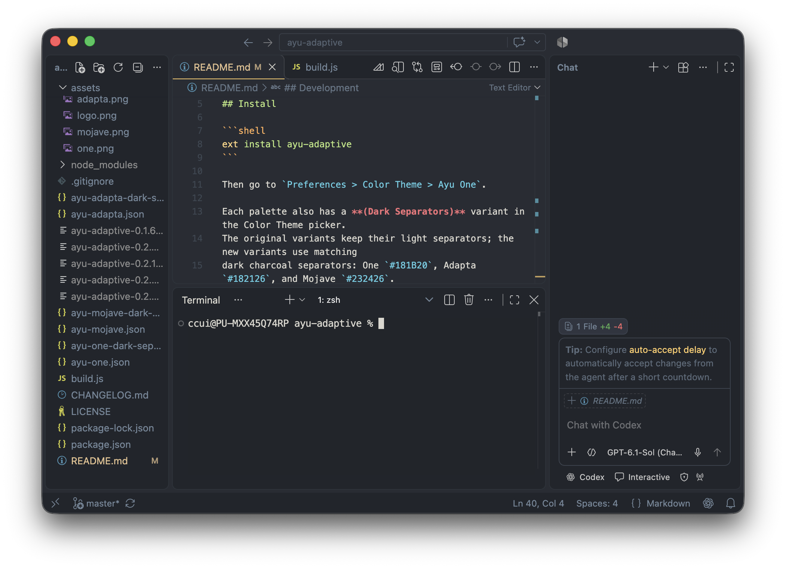
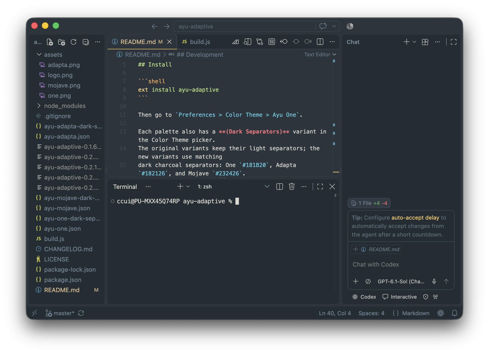
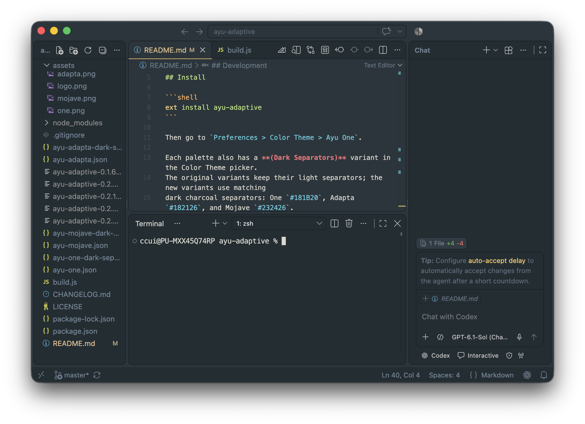
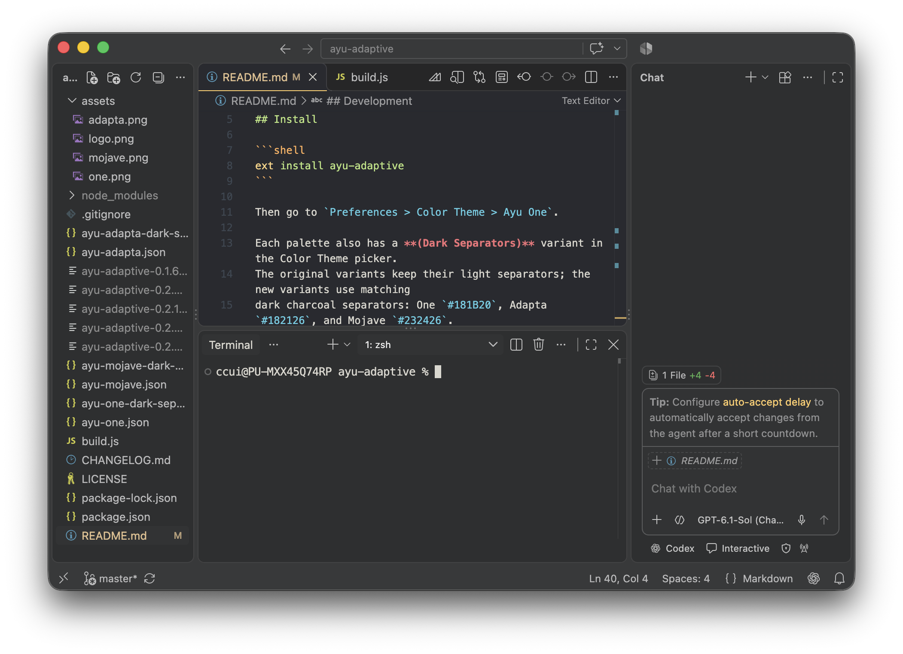
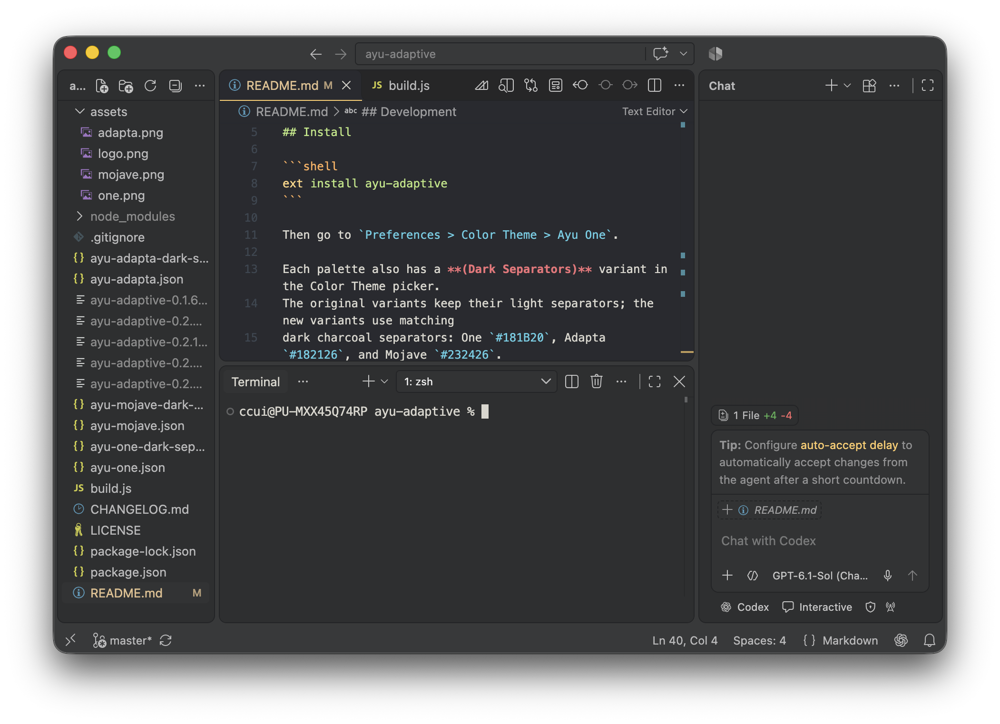

A modification of [vscode-ayu](https://marketplace.visualstudio.com/items?itemName=teabyii.ayu) with Atom One, Adapta GTK and macOS Mojave color palette.

## Install

```shell
ext install ayu-adaptive
```

Then go to `Preferences > Color Theme > Ayu One`.

Each palette also has a **(Dark Separators)** variant in the Color Theme picker.
The original variants keep their light separators; the new variants use matching
dark charcoal separators: One `#181B20`, Adapta `#182126`, and Mojave `#232426`.

If you want to setup File Icon, install the original [vscode-ayu theme](https://marketplace.visualstudio.com/items?itemName=teabyii.ayu) then go to Preferences > File Icon Theme > Ayu.

## Screenshots

Previews of the current VS Code UI, including the editor, terminal, and Chat panel.

### Ayu One


### Ayu One (Dark Separators)


### Ayu Adapta


### Ayu Adapta (Dark Separators)


### Ayu Mojave


### Ayu Mojave (Dark Separators)


## Development

Install dependencies
```shell
npm install
```

Update themes and Build VSIX package
```shell
npm run build && npm run package
```
